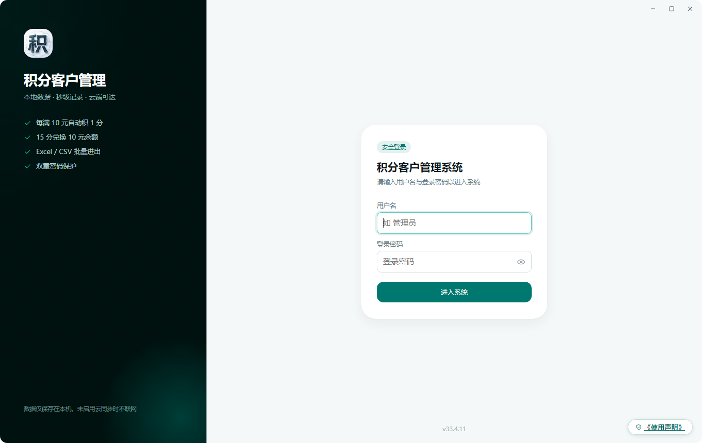
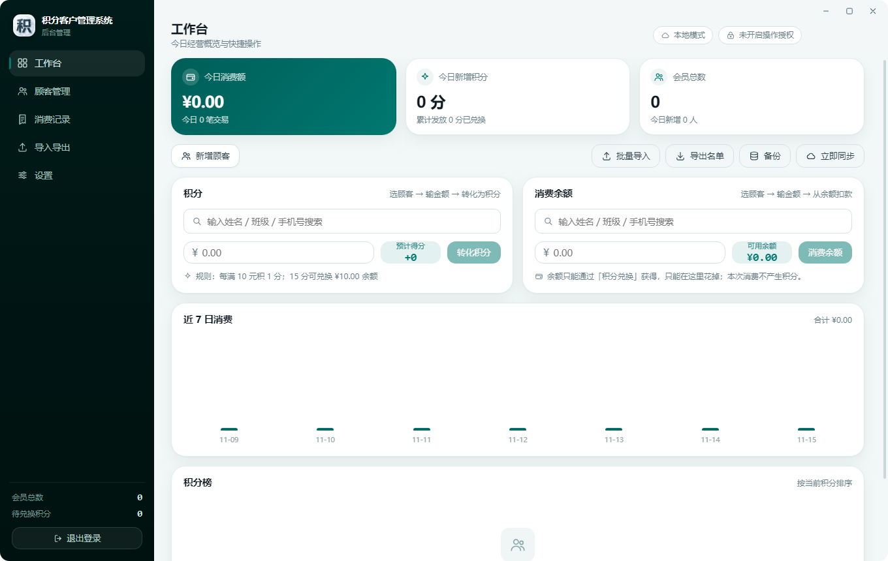
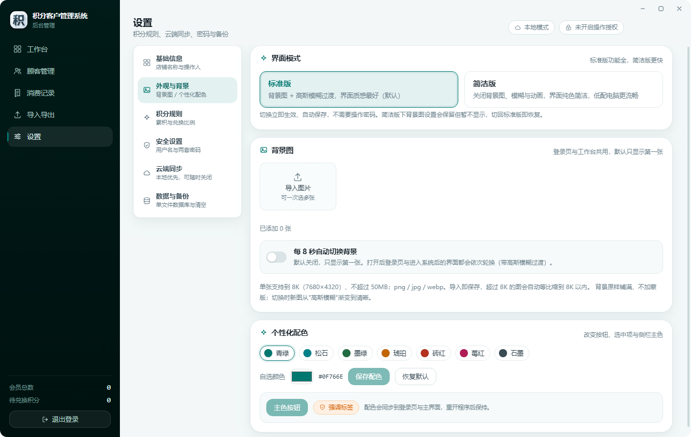
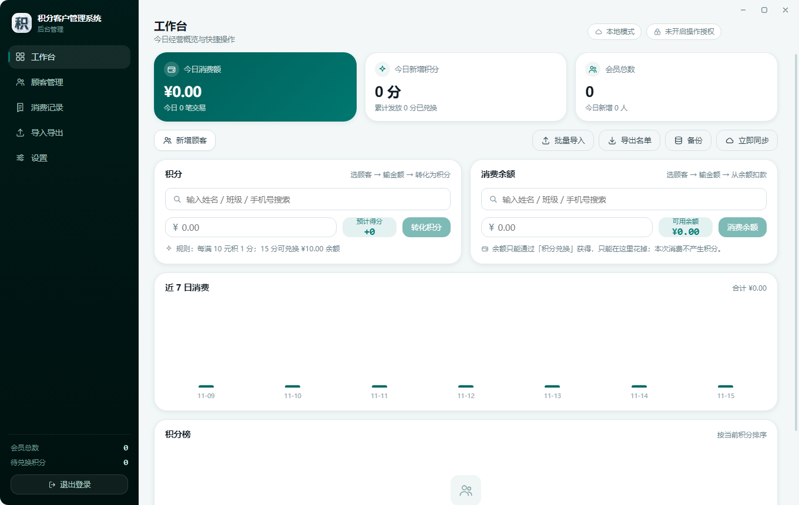
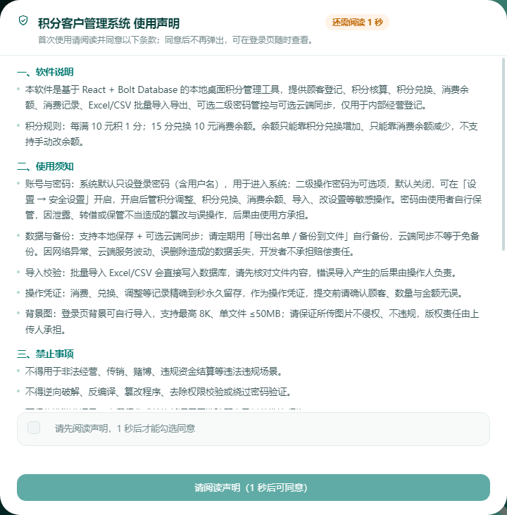
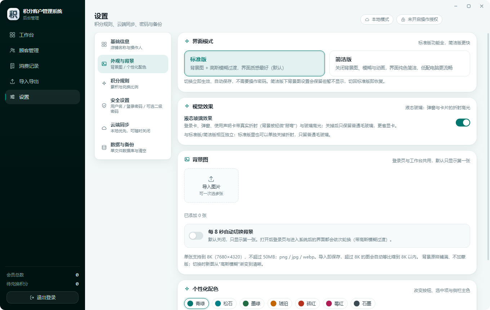
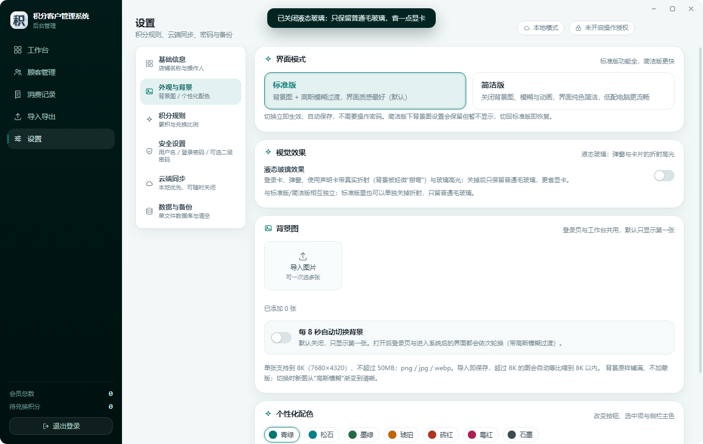
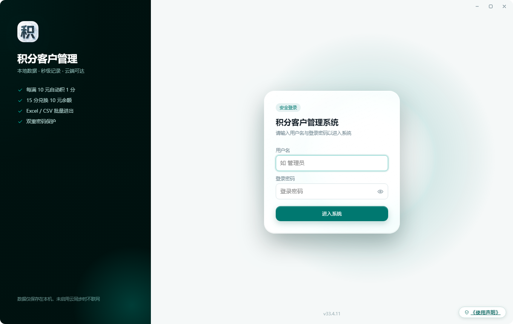
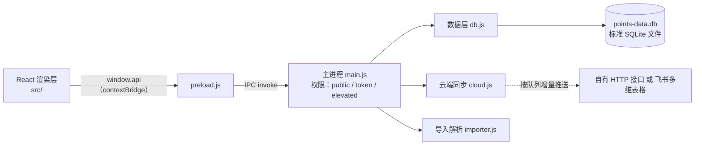

<p align="center">
  
</p>

<h1 align="center">积分客户管理系统</h1>

<p align="center">
  面向教培 / 培训班 / 小门店的 Windows 桌面会员积分管理工具<br/>
  Electron + React + SQLite（sql.js），本地优先、双击即用、不联网也能跑
</p>

<p align="center">
  
  
  
  
  
  
</p>

<p align="center">
  <a href="#-界面预览">界面预览</a> ·
  <a href="#-功能特性">功能特性</a> ·
  <a href="#-快速开始">快速开始</a> ·
  <a href="#-目录结构">目录结构</a> ·
  <a href="#-测试与自检">测试</a> ·
  <a href="#-常见问题">FAQ</a>
</p>

---

## 📖 这是什么

一个把「顾客积分账本」做成桌面软件的项目：

- **不是网页、不需要服务器**：Electron 打包成 exe，双击运行，离线可用。
- **数据是标准的 SQLite 文件**：可以用任意 SQLite 工具打开、导出、备份、迁移，不做私有格式锁定。
- **密码保护**：登录密码（用户名 + 密码）进入系统；二级操作密码可选、**默认关闭**，在「设置 → 安全设置」一键开启后，改动数据前需二次确认（scrypt + 随机盐哈希，本机不可逆）。
- **两种界面模式**：标准版（背景图 + 高斯模糊过渡，观感优先）/ 简洁版（关掉背景与全部动画，老电脑更跟手）。

适合场景：积分兑换礼品或抵扣消费的小店、培训班学员积分、会员储值式的余额消费（余额只能由积分兑换产生，不允许手工改余额）。

---

## 🖼 界面预览

| 登录页 | 工作台 |
| --- | --- |
|  |  |

| 设置 · 界面模式（标准版） | 简洁版工作台 |
| --- | --- |
|  |  |

| 液态玻璃 · 开（背景被折射） | 液态玻璃 · 关（不透明白卡） |
| --- | --- |
|  |  |

| 设置 · 视觉效果开关（开） | 关掉后只留普通毛玻璃 |
| --- | --- |
|  |  |

| 鼠标聚光 · 登录页 | 鼠标聚光 · 工作台 |
| --- | --- |
|  |  |

> 截图由项目内的离屏脚本（`app/scripts/brand-shot.js`、`app/scripts/ui-mode-shot.js`、`app/scripts/glass-shot.js`、`app/scripts/liquid-shot.js`）真实渲染后捕获，非设计稿。

---

## ✨ 功能特性

### 工作台
- 三张指标卡：今日消费额 / 今日新增积分 / 会员总数。
- **积分**：搜顾客 → 输金额（只接受数字与小数点，回车即提交）→ 实时显示「预计 +N 分」→ 一键把金额换成积分（**不动余额**）。
- **消费余额**：同一套操作，显示可用余额与消费后余额 → 一键从余额扣款（**不产生积分**，余额不足直接拦住）。
- 消费余额选中顾客后，可直接在该卡片内做**积分兑换**（弹窗支持「全部（N 份）」一键选到最大值）。
- 近 7 日消费柱状图 + 积分榜。

### 顾客管理
- 姓名 / 班级 / 手机号即时搜索，班级下拉筛选，7 种排序（最新建档、积分高低、余额、累计消费等）。
- 每行操作：消费余额、转化积分、积分兑换、手动调整、编辑、删除。
- **手动调整**：只能改积分、不能改余额；开启二级操作密码后**每次都必须重新输入**（不受操作授权影响）。
- 有交易记录的顾客禁止删除，避免账目出现缺口。

### 消费记录
- 时间**精确到秒**，按类型（积分转化 / 消费余额 / 充值 / 兑换 / 调整）、日期区间、关键字筛选。
- 顶部汇总：记录数、消费合计、积分变动、余额变动；可一键导出当前筛选结果。

### 导入导出
- 顾客名单 / 消费记录：Excel（.xlsx）与 CSV 双向导入导出，附模板下载。
- 同名同班精确匹配；顾客超过 500 人也不再用逐行分页查询（导入前一次性建索引）。
- CSV 读取自动识别编码：UTF-8 优先，遇到乱码回退 **GBK**（中文 Excel 另存的 CSV 直接可导）。
- 逐行容错：单行出错不会整批失败，会列出具体行号与原因。

### 设置
- 左侧二级栏目：基础信息 / 外观与背景 / 积分规则 / 安全设置 / 云端同步 / 数据与备份。
- **界面模式**：标准版 ↔ 简洁版，点击即生效、自动保存，不需要操作密码。
- **背景图**：可导入多张（单张最大 8K、≤ 50MB），登录页与主界面共用，原样铺满不加蒙版；可开启每 8 秒轮播（默认关闭）；切换时「高斯模糊 → 清晰」。
- **个性化配色**：7 个预设 + 任意 `#RRGGBB` 取色，实时预览，保存后持久化。
- 安全设置：改用户名 / 登录密码，并在此**开启、关闭、修改二级操作密码**（关闭需验证当前操作密码）。

### 其它
- **使用声明**：首次启动强制倒计时 10 秒后才能勾选同意，同意时间写入数据库；登录页右下角可随时重看。
- **无边框圆角窗口**：自绘最小化 / 最大化 / 关闭，连续曲率圆角，最大化时自动直角化。
- **单实例运行**：重复启动会聚焦已有窗口，避免两个进程同时写库。
- **云端同步（可选）**：本地优先，未启用时零网络请求。

---

## 🧮 积分与余额规则

默认规则：**每满 10 元积 1 分；15 分兑换 10 元余额。** 可在设置页修改，规则改完只影响之后的交易。

| 项目 | 规则 |
| --- | --- |
| 得分 | `floor(本笔金额 / 10) * 1`，**按单笔取整**，不做跨笔累计 |
| 兑换 | 按「份」计：1 份 = 15 分 → 10 元余额；份数不足直接拦 |
| 转化积分 | 只加积分 + 累加累计消费，**余额不变** |
| 消费余额 | 只扣余额 + 累加累计消费，**不产生积分**，不允许透支 |
| 手动调整 | 只能改积分，不能改余额；开启二级密码后每次都要输入 |
| 余额来源 | 只能由**积分兑换**产生，只能由**消费余额**消耗 |

> 想改成跨笔累计或四舍五入，只需修改 `app/electron/db.js` 里的 `pointsForAmount()`。

---

## 🛠 技术栈

| 层 | 选型 | 说明 |
| --- | --- | --- |
| 桌面壳 | Electron 33 | Windows x64，无边框自绘窗口 |
| 界面 | React 18 + Vite 5 | 纯 CSS（无 UI 框架），自定义设计变量 |
| 数据 | sql.js 1.10（SQLite WASM 构建） | 无原生模块，免编译，跨机器直接跑 |
| 表格 | SheetJS (xlsx) 0.18 | Excel / CSV 读写，含 GBK 回退 |
| 打包 | electron-builder 26（NSIS） | 安装包 + 免安装目录双形态 |
| 安全 | Node `crypto.scrypt` + 随机盐 | 登录密码必设、二级操作密码可选，均加盐哈希不可逆 |

### 架构



关键设计：**渲染层不直接碰数据库**。所有写操作走 IPC，主进程按 `{ public / 需要登录 token / 启用二级密码后需要操作授权 }` 分级校验，界面上的按钮限制只是第一道门，服务端（主进程）会二次校验。

---

## 🚀 快速开始

### 环境要求
- Windows 10 / 11 x64
- Node.js ≥ 18（建议 20 LTS）
- npm（项目内 `.npmrc` 已配置国内镜像，含 electron / electron-builder 二进制镜像）

### 开发运行

```powershell
cd app
npm install

# 方式一：直接跑打包后的界面（改完代码需重新 build:render）
npm run build:render
npm start

# 方式二：前端热更新（两个终端）
npm run dev:render                      # 终端 A，Vite 5173
$env:VITE_DEV_SERVER_URL="http://localhost:5173"; npm start   # 终端 B
```

### 打包

```powershell
cd app
npm run build:installer     # 产出 release\积分客户管理系统-安装包-1.1.9.exe（NSIS）
```

或在仓库根目录使用一键脚本（会先构建界面再同步 / 打包）：

```powershell
.\重新构建.ps1      # 构建 dist 并同步到免安装目录 积分客户管理系统\
.\构建安装包.ps1    # 构建 + 打 NSIS 安装包，并复制到仓库根目录
```

> 打包前请先关闭正在运行的实例：`Get-Process -Name '积分客户管理*' | Stop-Process -Force`，否则文件被占用会导致打包失败。

---

## 📁 目录结构

```
.
├── app/                        # 完整源码
│   ├── electron/
│   │   ├── main.js             # 主进程：窗口、IPC 路由与权限分级
│   │   ├── preload.js          # contextBridge 暴露 window.api
│   │   ├── db.js               # 数据层：建表、设置、积分规则、顾客/流水、备份
│   │   ├── importer.js         # Excel / CSV 解析、顾客索引、GBK 回退
│   │   └── cloud.js            # 云同步适配器（generic / feishu）
│   ├── src/
│   │   ├── App.jsx             # 路由与外壳、界面模式门控、自绘窗口按钮
│   │   ├── styles.css          # 设计变量（圆角刻度、配色）与 ui-lite 规则
│   │   ├── components/         # Login / Dashboard / Customers / Records / DataIO / Settings / TermsGate / TxModal
│   │   └── assets/brand-logo.png
│   ├── scripts/                # 离屏回归与截图脚本（见下）
│   ├── build/                  # 应用图标 icon.ico / icon.png
│   └── package.json            # 脚本、依赖、electron-builder 配置
├── docs/
│   ├── icon.png
│   └── screenshots/
├── 积分客户管理系统/             # 免安装目录版成品（可选提交 / 建议走 Release）
├── 积分客户管理系统-安装包-1.1.9.exe
├── 重新构建.ps1
├── 构建安装包.ps1
├── 使用说明.md                  # 面向使用者的完整手册
├── 修改指南.md                  # 面向二次开发：每处功能怎么改
└── 云端同步接入说明.md           # 两种云同步对接步骤
```

---

## 💾 数据与备份

| 内容 | 位置 |
| --- | --- |
| 主数据库 | `%APPDATA%\积分客户管理系统\data\points-data.db` |
| 备份文件 | `%APPDATA%\积分客户管理系统\data\backups\` |
| 背景图 | `%APPDATA%\积分客户管理系统\login-bg\`（只存文件，库里存 `file:///` 地址） |

- 数据库表：`customers`、`transactions`、`settings`、`sync_queue`（含姓名 / 班级 / 时间索引）。
- **备份 = 复制这个 .db 文件**。安装包卸载默认**不删数据**，重装后接着用。
- 迁移到另一台电脑：拷 `data\points-data.db` 过去即可（建议同时拷 `login-bg\`）。
- 注意别把大图塞进数据库：sql.js 每次落盘都会整库重写，50MB 背景图会让每笔交易变卡，所以图片单独存文件。

---

## 🔐 安全设计

- 登录密码、二级操作密码分别用 **scrypt + 独立随机盐** 哈希，只存哈希，不可逆、无后门、**不支持找回**。
- 登录密码必设、至少 4 位；二级操作密码默认关闭，开启时同样至少 4 位且不能与登录密码相同；用户名大小写不敏感。
- 开启二级操作密码后，每次登录验证一次即生效；之后**连续 5 分钟内有操作就一直有效**，超过 5 分钟没有任何鼠标/键盘操作则授权失效，下一次敏感操作需重新输入。但「手动调整」是例外——**每次都强制重输**。关闭时敏感操作只校验登录身份。
- 主进程对所有写操作做**二次校验**，不依赖界面禁用；积分与余额都不会被扣成负数。
- 渲染层开启 `contextIsolation`，只通过 `preload` 暴露白名单方法，不开放 `nodeIntegration`。
- 首次使用必须阅读《使用声明》并**倒计时 10 秒**后才能同意，记录同意时间。

> 提醒：这是本地软件，拥有电脑文件访问权的人可以直接拷贝 / 替换 `.db` 文件。要防「拿到文件就能改数据」，需要在操作系统层做磁盘加密与账号隔离，软件本身无法替代。

---

## ☁️ 云端同步（可选）

本地优先（local-first）：所有写操作先落本地库 + 写入 `sync_queue`，再按队列增量推送；推送失败自动标记重试，**不阻塞收银**。

| 适配器 | 适用 |
| --- | --- |
| `generic` | 自有 HTTP 接口，POST JSON 批量记录，支持 `Bearer` Token |
| `feishu` | 飞书多维表格（Bitable），自动映射「顾客表 / 消费记录表」字段 |

未开启时程序**不发任何网络请求**。详细配置步骤见 [云端同步接入说明.md](./云端同步接入说明.md)，仓库 `工具\云端接收端示例.js` 提供可直接运行的接收端示例。

---

## 🎛 界面模式与性能

| | 标准版（默认） | 简洁版 |
| --- | --- | --- |
| 背景图 | 显示，支持多张轮播 | 不加载（设置保留，切回即恢复） |
| 高斯模糊过渡 | 页面切换、弹窗、背景切换 | 全部关闭，`animation / transition: none` |
| 弹窗毛玻璃 | `backdrop-filter: blur()` | 关闭 |
| 卡片阴影 | 完整层次 | 降级为 `0 2px 8px` |
| 加载动画 | 正常 | 保留（否则看不到加载状态） |

切换入口：**设置 → 外观与背景 → 界面模式**，立即生效、自动保存、不需要操作密码。老机器或远程桌面场景建议简洁版。

---

## 🗒 更新日志

**v1.1.9（2026-11-28）· 已打包安装包 1.1.9**

- **安装包**：`PointsCustomerManager-Setup-1.1.9.exe`（约 78 MB，NSIS、x64），见 [Releases](https://github.com/177313596/points-customer-manager/releases/tag/v1.1.9)。
- **使用声明不再卡阅读倒计时**：右上角"还需阅读 N 秒"的徽标整块删除，勾选框从声明弹出那一刻就能点，不再等 10 秒。文案也从"请先阅读声明，N 秒后才能勾选同意"回到正常的同意条款。
- **未勾选时底部按钮不再是"禁止键"**：以前未勾选（或倒计时未满）时按钮挂禁用态，悬停是一条禁止符、点了没反应。现在按钮始终是正常的主色实心按钮、`cursor: pointer`，点下去会给一句"请先勾选下方「我已阅读并同意」"的提示，同时把勾选行**轻轻晃一下（±4px、0.6s）**并把方框描边变暖橙，告诉你要点哪里；勾选后按钮文案自然变成"同意并继续"。
- 回归：`headless-check.js` 的使用声明断言全部换新（`termsTimerRemoved` / `termsButtonNeverDisabled` / `termsCheckboxNotLocked` / `termsButtonCursorPointer` / `termsUncheckedClickHints` / `termsUncheckedClickNudges`），实测按钮 `cursor: pointer`、无 `disabled` 与 `aria-disabled`、未勾选点击后勾选状态仍为 false 且提示出现，**RESULT ALL-PASS**。

**v1.1.8（2026-11-28）· 本轮未重打安装包，安装包仍为 1.1.6**

- **启动不再空转 500ms 的转圈**：直接进登录页，首次加载（`status`）交给骨架屏承接，不再"转圈 → 骨架"两套加载器接力。
- **加载骨架屏**：登录前和进入主界面时，先按真实布局摆灰色占位块（登录卡、左侧菜单卡、统计卡、快捷行、两块内容卡、7 日柱图、积分榜），再在整个骨架上盖一层半透明光带——从左侧进、到右侧出，**1.5s 一轮、linear、无限重复**，只改 `transform`，交给合成层走。白底上纯白光看不出来，所以光带两侧带一点很淡的青灰（品牌冷色），亮底、灰块、深色菜单三处都能看到这道光在移动。
- **进度条只跟真实进度**：节点就是实际完成的请求（登录前的 `status`、主界面的 `settings` + `stats`）。每完成一步，填充条用 `translate3d` 挪到对应比例，`0.3s` 过渡补平；正在挪的时候来了新进度，就从当前位置接着挪。**不自己编进度，也不补假步数**。
- **进入主界面的节奏**：数据齐了之后至少再留 520ms（若数据回来得晚，也至少留 320ms 把最后一次位移走完），确认填充条真的走到位才切真实界面，不会出现"进度条还没满就跳走"。
- **卡片入场**：每张卡从 `blur(14px)` + 透明一起回到正常，**700ms**；按 DOM 顺序用 `--reveal-i` 算出延迟，**每张递增 0.05s**。用 layout effect 在首次绘制前挂类名，不会先闪一帧清晰卡片。页面切换的容器动画同步改成纯透明度淡入（0.24s），模糊只由卡片做，避免两层 `filter` 叠着糊成一片。
- **数字滚动**：工作台三张统计卡（消费额 / 新增积分 / 会员总数）与左侧菜单底部的会员总数、待兑换积分，进入主界面时从 0 滚到目标值（900ms、easeOut、等宽数字）。滚过一次就置位，之后在工作台与其它页面之间来回切不再重滚，数据刷新直接换值。
- **注册完成的「可设置二级密码」提醒挪到主界面**：以前是注册成功后在登录页立刻弹，现在先进主界面，等卡片入场（700ms + 错峰）走完、再等 1.1s 才弹；「现在去设置」直接跳到「设置 → 安全设置」。注册表单本身仍然只要用户名 + 登录密码，二级密码默认关闭。
- 简洁版 / 系统「减少动态效果」：骨架屏保留灰块但**没有扫光**，卡片不做模糊入场，数字直接显示终值（`ui-lite` 的 `animation / transition: none` 一并对新动效生效）。
- 回归：`headless-check.js` 更新断言（`.page-fade` 现在是 `pageIn`、卡片 `cardIn` 700ms + 0.05s 错峰、扫光 1.5s/linear/infinite 且简洁版下为 `none`），**ALL-PASS**；新增 `scripts/load-anim-check.js`、`load-anim-detail.js`、`load-anim-deliver.js`、`load-anim-sweep-shot.js` 用于逐帧采样与截图。实测填充条轨迹 0 → 36% → 52% → 73% → 85% → 99% → 切界面，卡片延迟 0 / 0.05 / 0.10 / 0.15 / 0.20 / 0.25 / 0.30s，入场首帧 `blur(14px)` + `opacity 0`。

**v1.1.7（2026-11-28）· 本轮未重打安装包，安装包仍为 1.1.6**

- 左侧菜单不再贴着窗口边，改成一张**独立浮起的卡片**（四周 10px 间隙、22px 连续曲率圆角），菜单项与底部统计都在卡片里。
- **所有卡片改成磨砂玻璃**：内容卡、统计卡、登录卡、设置页二级栏目、左侧菜单。做法是三层——冷白奶白渐变打底（刻意压在 245~250 之间，给"被照亮"留出亮度余量）、`backdrop-filter: blur(16px) saturate(1.35)` 做磨砂（菜单是深色玻璃 + `blur(18px)`）、内侧 1px 高光边加柔和投影做出厚度。主色统计卡保留青绿渐变，只补玻璃高光边。
- 应用背景图改为铺在**整个外壳**底层，菜单玻璃因此能透出背景的模糊色块（以前背景图只铺在内容区，菜单下方是纯色，看不出玻璃）。
- **悬停光斑**：卡片内部跟随光标出现一团 260px 的柔和径向光，中心加亮、边缘依次压暗（纯白卡片直接叠白色顶到 255 就看不见了，所以按真实打光关系做"中心亮 + 四周落回阴影"）。深色菜单换成偏青的冷光。
- **边框局部提亮**：同一组坐标画一圈亮环，用 `mask` 裁成 1px，只在光标附近那段边框发光。
- **3D 倾斜**：按指针偏离卡片中心的距离算 `rotateX/rotateY`，上限 4°，透视 900px；指针移出后以 0.72s 的曲线平滑归位。`--tx/--ty/--mx/--my` 用 `@property` 注册成可插值属性，所以角度和光斑位置都是连续变化，不跳帧。
- 交互全部写在 `src/glass.js`，只改 CSS 变量、不进 React 状态：pointermove 只记录坐标并合并到一帧 rAF；滚动、失焦、窗口缩放时自动熄灯。
- **修了一个倾斜带来的隐患**：菜单胶囊原先用 `getBoundingClientRect` 量位置，卡片倾斜后 rect 是透视投影值，写回卡片内的 `translate3d` 会落偏（越大越偏）。改成 `offsetTop/offsetWidth` 这类布局坐标后，倾斜 2.6° 时实测落点误差 0.77px（设置页 0.07px，无倾斜时 0）。
- 简洁版：关掉模糊、光斑、提亮与倾斜，退回不透明实体卡；系统「减少动态效果」保留光斑但去掉倾斜。

**v1.1.6（2026-11-28）**

- 删除**鼠标聚光效果**：原先跟随指针滑动的 760px 白色柔光层（`Spotlight` 组件 + `.spotlight` 样式）整体移除，登录页和后台页都不再渲染这一层。背景现在只有背景图本身 + 玻璃菜单，不再有指针移动时的光斑。
- 连带清掉它的 rAF 循环、`pointermove` / `pointerdown` / `pointerleave` 三个全局监听和 4.5 秒淡出定时器，空闲时不再有后台渲染开销。
- `headless-check.js` 的对应断言改为 `spotlightRemoved`（断言页面里 `.spotlight` 节点数为 0），全量回归 ALL-PASS。

**v1.1.5（2026-11-28）**

- 菜单当前项改成**半透明玻璃胶囊**：整块胶囊在侧边栏里滑到当前项下面，不再是每项各自变色。玻璃由三层叠成——冷白渐变底（体）、`backdrop-filter: blur(9px) saturate(1.45)`（透）、`inset 0 0 0 1px` 描边 + 内侧顶光（边缘那一圈细高光），底部再加一道内侧暗影撑出厚度。
- 切换动效是**真弹簧**（`NavPill` 组件，每帧积分 `a = -KΔ - Cv`，K=260、C=21，ζ≈0.65）：滑行约 0.3 秒、到位过冲 8% 再回弹；移动中按瞬时速度沿运动方向拉伸（最高 +20%）、垂直方向同步压扁 45%，速度归零自动缩回，所以"拉长 → 滑行 → 回弹"是一个连续过程。
- 设置页二级栏目用同一套组件、换浅色玻璃配方（`set-pill`：白面渐变 + 青绿描边），两处选中态视觉统一。
- 去掉原来 `.nav-item.active` 的纯色底和左侧 3px 竖条，选中态完全由胶囊承担；`:not(.active):hover` 保留悬停反馈。
- 简洁版 / 系统「减少动态效果」：胶囊保留但不跑 rAF，点击直接吸附到位；简洁版同时关掉 `backdrop-filter`。
- 新增 `app/scripts/pill-shot.js`：逐帧采样 `transform` 量化拉伸峰值与过冲（实测拉伸 +18.2%、过冲 2.8px、精确落位 0 误差），并抓取运动中 / 到位后画面。

**v1.1.4（2026-11-28）**

- 应用图标与安装包图标改为**连续曲率圆角（squircle）**：四角不再是普通圆弧，而是超椭圆曲线 `|x/a|^n + |y/b|^n = 1`（n=5，接近 iOS / macOS 图标曲率），从边到角曲率连续过渡、没有"直切—拐弯"的硬转折。
- 实现方式：`app/scripts/make-icon.ps1` 内置 `SquircleMask`（C# + 4×4 超采样算像素覆盖度），对每个尺寸单独做遮罩再做抗锯齿，所以 16px 的小图标边缘也不会出现锯齿或灰边；四角透明、内部 alpha 一律拉满 255。
- 覆盖范围：`build/icon.png`（窗口/任务栏图标，512）、`build/icon.ico`（16/24/32/48/64/128/256 七帧）→ 应用 exe、开始菜单与桌面快捷方式、安装包与卸载器图标全部同步更新。原始方角图备份在 `app/build/icon-orig.png`，换回方角只需 `.\scripts\make-icon.ps1 -Source build\icon-orig.png -SquircleN 0`。
- 新增 `app/scripts/check-exe-icon.ps1`：从 exe / 安装包里抽 256px 图标拼对比图，用于确认圆角是否真的进了二进制。

**v1.1.3（2026-11-21）**

- 标准版新增**鼠标聚光**：一层跟着指针缓慢滑动的柔光（白色核心 + 品牌色光晕），铺在背景图之上、内容卡片之下，所以背景被照亮而卡片、数字不受影响。
- 细节：指针移动时淡入，静止 4.5 秒后自动淡出；用 `rAF` + 0.13 缓动跟随，指针停在原处不会抖动、无重排开销；`pointer-events: none`，完全不挡点击。
- 简洁版整层不渲染（`body.ui-lite .spotlight { display: none }`），与液态玻璃、界面模式互不干扰。
- 回归新增 `spotlightLayer` 断言（标准版 `display:block`、`pointer-events:none`、简洁版 `none`、`aria-hidden=true`），新增 `app/scripts/spot-shot.js` 截图脚本（用真实 mouseMove 事件把指针推到位再截）。

**v1.1.2（2026-11-20）**

- 新增**独立开关「液态玻璃效果」**（设置 → 外观与背景 → 视觉效果）：登录卡、弹窗、使用声明卡变成半透明玻璃，背景透过卡片时被**真实折射**（`backdrop-filter: url(#lg-refract)` 的 SVG 位移滤镜，不是简单模糊），并带内侧玻璃高光与染色。
- 液态玻璃与标准版 / 简洁版**相互独立**：标准版默认开启，可单独关掉只保留普通毛玻璃（更省显卡）；简洁版一律强制关闭，开关呈灰态并提示「固定关闭」。
- 开关即时生效、自动保存，**不需要操作密码**；主内容区的卡片与数字保持不透明，避免影响读数。
- 回归新增 `glassSwitch`（body 类、`url(#lg-refract)` 折射、简洁版为 `none`、关闭后回 `none`、滤镜节点存在）、`hasLiquidGlassSwitch`（设置页文案与开关默认开启）以及 `ui-mode-test.js` 的 7 项液态玻璃 IPC 断言；新增 `glass-shot.js` / `liquid-shot.js` 两组真实渲染截图脚本。

**v1.1.1（2026-11-20）**

- 操作密码改为**空闲 5 分钟失效**：登录后验证一次即生效，之后只要连续 5 分钟内有鼠标/键盘操作就一直是授权状态（右上角倒计时随操作刷新），超过 5 分钟没有任何操作才需要重新输入；退出登录、修改操作密码都会立即清空授权。「手动调整积分」仍每次强制输入。
- 美化《使用声明》的勾选框：视觉 18×18 圆角方块（选中为品牌色渐变 + 白色对勾），外层 36×36 透明热区，整行 48px 高都能点，点视觉方框以外的空白同样能勾上。

**v1.1.0（2026-11-20）**

- 二级操作密码改为**可选**：注册只设用户名 + 登录密码，操作密码默认关闭，可在「设置 → 安全设置」随时开启 / 关闭 / 修改，注册完成后弹窗提醒可去设置开启。
- 修复《使用声明》闸门的点击缺陷：勾选方框与「同意并继续」周边区域此前落在 `disabled` 控件上，Chromium 会直接吞掉鼠标事件导致完全无反应。现改为整行可点的自绘勾选框（20px 方框 + 36px 热区）、按钮始终可点并在未就绪时给出明确提示、底部留白也可点击，倒计时内点击会提示「还需阅读 N 秒」而不是静默无响应。
- 回归脚本新增 `op-optional-test.js`（15 项）与 `terms-hit-verify.js`（真实鼠标事件验证热区）。

**v1.0.0（2026-11-13）**

- 首个发布版本：标准版 / 简洁版双模式、登录密码 + 操作密码、Excel/CSV 导入导出、背景图与个性化配色、10 秒使用声明。

---

## ✅ 测试与自检

`app/scripts/` 下是一组**离屏 Electron 回归脚本**，全部在临时目录跑，不触碰真实数据文件：

| 脚本 | 覆盖 |
| --- | --- |
| `headless-check.js` | 90+ 条界面断言（登录、工作台、顾客、记录、设置、窗口按钮、背景层、`uiModeSwitch`、`glassSwitch`、`hasLiquidGlassSwitch`…） |
| `ui-mode-test.js` | 19 项界面模式与液态玻璃 IPC 断言（默认值、权限、非法值、落库、关闭后 status 同步） |
| `io-import-test.js` | 导入回归：同名不同班精确匹配、按姓名命中、自动建档、GBK CSV |
| `bg-multi-ipc-test.js` | 多背景图增删清空、路径越界防护 |
| `pw-change-test.js` | 双密码修改与校验 |
| `op-optional-test.js` | 操作密码可选的 15 项断言（默认关闭、开启后强制校验、错密码拒、关闭后免密） |
| `op-idle-test.js` | 空闲超时回归：授权内免密、空闲超窗口要重输、活动上报续期、重登后清空 |
| `terms-hit-verify.js` | 使用声明热区回归：倒计时内点勾选框/按钮留白有提示、解锁后能勾上并同意 |
| `terms-test.js` | 使用声明倒计时与同意持久化 |
| `ui-mode-shot.js` / `brand-shot.js` / `mainbg-shot.js` / `win-frame-check.js` | 真实渲染截图与窗口圆角校验 |
| `glass-probe.js` / `glass-shot.js` / `liquid-shot.js` | 液态玻璃：滤镜可行性探针、开/关折射对比截图、设置页开关截图 |
| `spot-shot.js` | 鼠标聚光：用真实 `sendInputEvent` 鼠标移动把指针推到位，再截登录页与工作台 |

```powershell
cd app
npx electron scripts/headless-check.js        # 期望输出 RESULT ALL-PASS
npx electron scripts/ui-mode-test.js           # 期望 19 项全 PASS
$env:PM_CSV_GBK="C:\path\to\gbk.csv"; npx electron scripts/io-import-test.js
```

日志建议重定向到文件再读（Electron 子进程的 stdout 在部分终端会被截断）：

```powershell
npx electron scripts/headless-check.js 2>&1 | Tee-Object -FilePath "$env:TEMP\check.txt" | Out-Null
```

---

## 📚 相关文档

| 文档 | 读者 | 内容 |
| --- | --- | --- |
| [使用说明.md](./使用说明.md) | 使用者 | 安装、首次初始化、五个页面怎么用、积分规则、数据位置、备份恢复 |
| [修改指南.md](./修改指南.md) | 二次开发者 | 界面模式怎么改、配色/圆角/背景、积分规则、IPC 权限、重新打包 |
| [云端同步接入说明.md](./云端同步接入说明.md) | 运维 / 开发者 | `generic` 与飞书多维表格两种对接方式 |

---

## ❓ 常见问题

<details>
<summary><b>打开后要求初始化，用户名密码填什么？</b></summary>

首次启动没有默认密码，需要自己设置用户名 + 登录密码（操作密码是可选项，默认关闭）。初始化完成后会弹窗提示「可设置二级密码」，点「现在去设置」直达设置页；之后随时可在「设置 → 安全设置」开启、关闭或修改。升级旧版本时用户名默认是 `admin`，也可在同一页修改。
</details>

<details>
<summary><b>忘记密码了怎么办？</b></summary>

无法找回（没有后门）。只能备份后删除 `%APPDATA%\积分客户管理系统\data\points-data.db` 重新初始化，数据会一起丢失——所以请定期用设置页的「备份到文件」。
</details>

<details>
<summary><b>为什么「手动调整」每次都要输密码？</b></summary>

这是刻意设计：它是唯一能直接改积分的入口，不受操作授权影响，避免有人借已授权状态偷偷改分。
</details>

<details>
<summary><b>余额能不能直接充值？</b></summary>

不能。余额只有一个来源（积分兑换）和一个出口（消费余额）。历史充值记录仍可在消费记录里按「充值」筛出查看。
</details>

<details>
<summary><b>能同时开安装版和免安装版吗？</b></summary>

不能，两者读写同一个数据目录且限制单实例，第二个启动会自动退出（会聚焦已开窗口）。
</details>

<details>
<summary><b>这台电脑很老，界面有点卡？</b></summary>

设置 → 外观与背景 → 切到**简洁版**：关闭背景图、全部动画与模糊，明显更跟手。
</details>

<details>
<summary><b>能做成安卓 APK 吗？</b></summary>

可以，但不是「换个打包命令」就行：Electron 不能直接编译到 Android。可行路线是 Capacitor 复用 React 界面（约 90% UI 代码可留），但主进程的 IPC、密码校验、文件读写都要重写到前端 + 原生插件，数据库可继续用 sql.js（.db 文件与桌面版互通）；同时 APK 里的 JS 可被反编译，安全性弱于桌面版。预计 10–14 个工作日，且低端安卓建议默认简洁版。
</details>

---

## 🧭 已知限制

- 仅支持 **Windows 10/11 x64**（未做 macOS / Linux 打包配置）。
- 安装包未做代码签名，首次运行可能触发 SmartScreen 提示（「更多信息 → 仍要运行」）。
- 云同步是「本地优先的增量推送」，不做双向冲突合并；多端同时改同一顾客需要人工确认。
- 密码只保护软件内的操作，不能防止有人直接替换数据库文件。

---

## 📄 许可与免责

- 本仓库为个人项目，`package.json` 中 `license` 为 `UNLICENSED`：**未授予商业使用、再分发或二次售卖许可**；如需授权请先联系作者。
- 软件按「现状」提供，不承诺适用于任何特定的经营 / 财务记账场景。积分与余额数据请自行定期备份并核对；因数据丢失、误操作或规则设置不当造成的损失，作者不承担责任。
- 涉及真实顾客姓名、手机号等信息时，请自行遵守《个人信息保护法》等适用法规，做好访问控制与备份加密。

<p align="center"><sub>Built with Electron · React · sql.js — 本地优先，数据始终在自己电脑上</sub></p>


